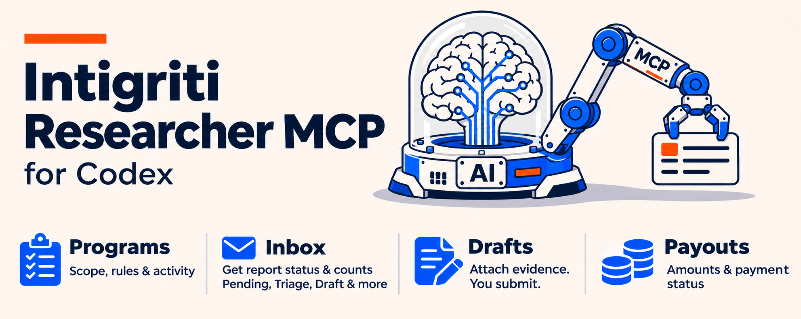

# Intigriti Researcher MCP



**v1.1.0 · Codex only.** Browse Intigriti programs, compare rules and scope changes, check payouts, and prepare researcher report drafts.

**Before saving or uploading, sign in to Intigriti and explicitly approve the destination draft, fields and exact files.** Codex uses its built-in **@Chrome** controls in your signed-in browser, with **@Computer** as the fallback. You handle sign-in and 2FA in that browser. You control final review and submission.

Use your browser's existing settings. If an available control can open the picker but cannot select a file, select the approved file yourself. Codex checks the saved attachment afterward. Developer mode and remote debugging are unnecessary.

## Connect to Codex

1. Clone this repository. From its root, run the following commands with Node.js 22 or newer and npm.

   ```sh
   npm ci
   npm run setup:codex
   ```

   Setup creates a local `.env` and configures `.codex/config.toml`. If setup prints a section to merge into an existing config, add it there.

2. For the six researcher account lookups, create a personal access token (PAT). Paste it after the equals sign in the project-root `.env` and save the file. Browser drafting uses your interactive Intigriti sign-in. [Create a researcher token](https://app.intigriti.com/researcher/personal-access-tokens)

   ```dotenv
   INTIGRITI_API_TOKEN=
   ```

3. Open this folder as a **trusted project** in Codex. If it is already open, restart Codex to load the configuration. Try this in a new chat.

   > Use Intigriti to show five open programs and their bounty ranges, including the currency.

## Available tools

| Tool | What it returns |
| --- | --- |
| `list_programs` | Program status, following state, bounty ranges and platform links |
| `get_program` | Current rules, version IDs and scope counts by asset type and tier |
| `list_program_activity` | Changes for one program, with version IDs where available |
| `get_scope_version` | Scope counts for a specific version |
| `get_rules_version` | Rules text, testing requirements and safe harbour status for a specific version |
| `list_payouts` | Personal payout amounts, currencies, statuses and dates |
| `prepare_report_draft` | A local report package or a browser handoff that Codex carries out using its built-in controls |

For a complete list, continue from `nextOffset` until it is `null`. A filtered page can be empty and still have a continuation.

## Draft a report

1. Say **“Draft an Intigriti report.”** Codex asks which program you want. Paste the program link or an existing draft link.

   Codex drafts from the verified finding you already discussed. Otherwise, point it to your finding notes and PoC files. If several findings fit, choose one. Include how AI helped prepare the report.

2. Sign in and give explicit permission for that draft and its listed files. Codex then opens the program’s **Create submission** page or reopens the identified draft. The same program can reopen an existing draft, so Codex checks its identity before entering text.
3. Codex fills the approved fields, uploads selected evidence, and reopens the draft to check the saved fields and attachment rows. Its handoff distinguishes verified changes from anything still pending. Open the returned draft link for final review and submit it yourself when ready.

You can prepare a private local package and resume using its returned `draftId`. To inspect an existing draft, give Codex its exact link. Deletion requires a separate request for the specific live draft and confirmation at the platform’s destructive dialog.

Use ordinary requests such as “check the draft status” or “cancel the handoff.” Codex handles the tool modes. `browser` prepares the approval request, `approve` records your permission, and `finish` records the observed browser results. `local` creates or resumes a package and can bind it to its live draft link. `status` shows the handoff state. `cancel` ends the handoff only. If neither built-in browser control is available, the local package stays prepared.

## Privacy

Program lookups return Public programs by default. If the company permits sharing a restricted program with your Codex environment, add its GUID to the comma-separated `INTIGRITI_ALLOWED_PROGRAM_IDS` setting in `.env` and restart Codex. [Researcher terms](https://kb.intigriti.com/en/articles/5466165-researcher-terms-conditions)

The MCP stores local snapshots as plain-text JSON under `~/.intigriti-researcher-mcp/drafts`. Snapshots include report text and evidence paths and metadata. Evidence files stay at the paths you selected. Report inputs, tool results and requested payout details enter the Codex conversation. [Reporting and attachment limits](https://kb.intigriti.com/en/articles/5379086-how-to-write-and-submit-a-good-report)

## Tests and license

Run `npm test` for the regression suite and `npm run test:draft` for offline draft acceptance checks. With a PAT configured, `npm run test:live` checks the six account lookups, including personal payouts.

For v1.1.0, ten live @Chrome rounds uploaded synthetic evidence and verified the files and report fields by reopening the unsubmitted draft. @Computer availability depends on the host's ability to verify the browser window.

Licensed under the [MIT License](LICENSE).
